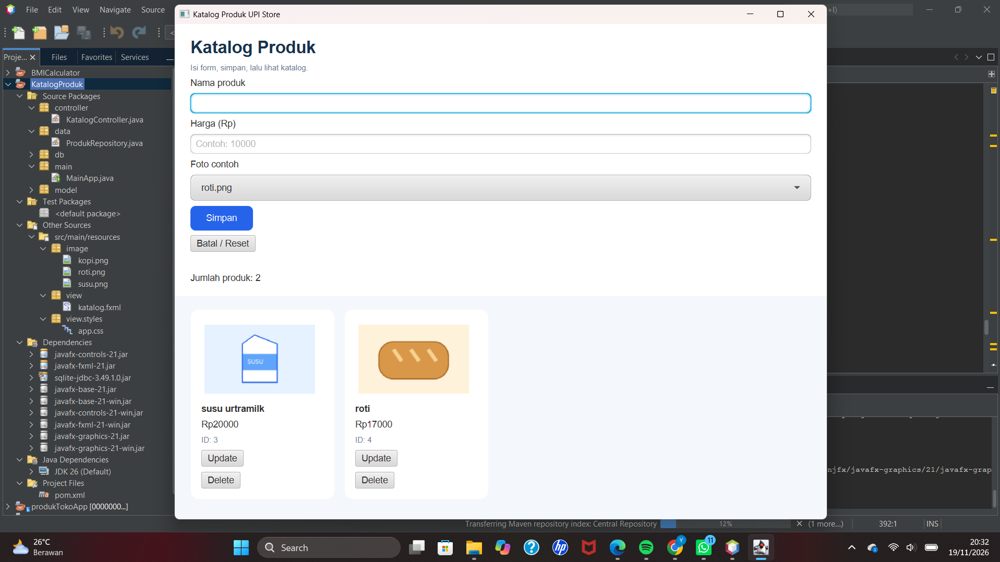
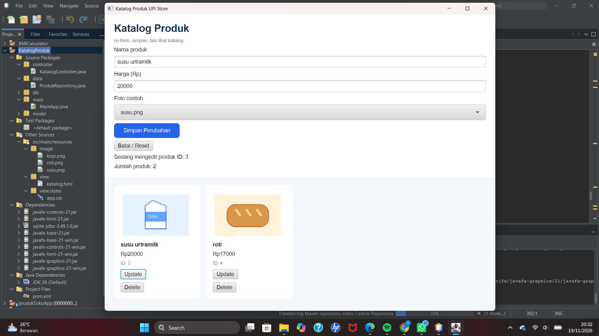
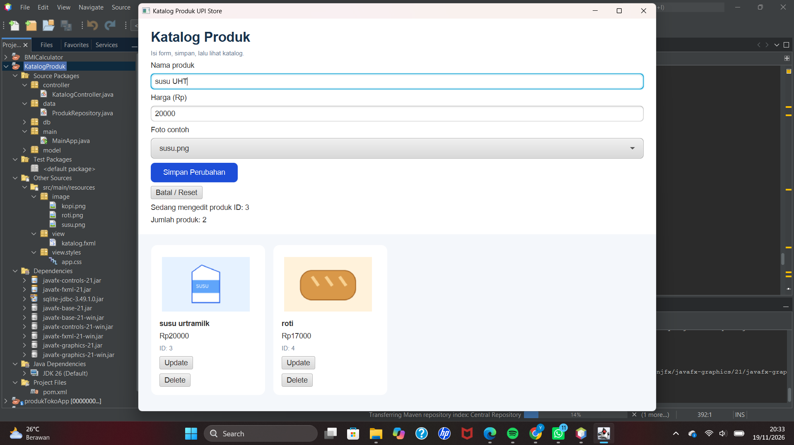
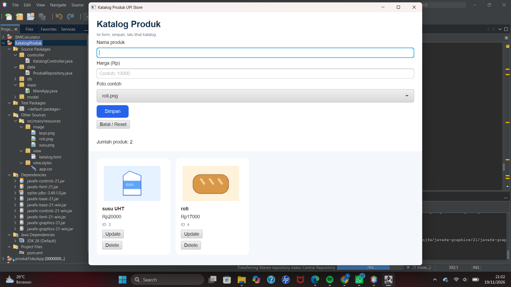

# Katalog Produk UPI Store

Aplikasi **Katalog Produk UPI Store** merupakan aplikasi desktop berbasis JavaFX yang dibuat untuk memenuhi tugas Pengantar JavaFX GUI - Level 3.

Aplikasi ini digunakan untuk mengelola data produk melalui antarmuka grafis (GUI). Pengguna dapat menambahkan, melihat, mengubah, dan menghapus data produk yang tersimpan dalam database SQLite.

## Fitur Aplikasi

1. **Create (Tambah Produk)**  
   Menambahkan produk baru dengan mengisi nama, harga, dan memilih foto produk.

2. **Read (Tampilkan Produk)**  
   Menampilkan seluruh data produk dalam bentuk kartu katalog yang dilengkapi foto, nama, harga, dan ID produk.

3. **Update (Ubah Produk)**  
   Mengubah informasi produk yang sudah tersimpan, seperti nama, harga, dan foto.

4. **Delete (Hapus Produk)**  
   Menghapus produk dari database dengan menampilkan konfirmasi sebelum penghapusan.

5. **Reset Form**  
   Mengosongkan formulir dan membatalkan proses pengeditan produk.

6. **Jumlah Produk**  
   Menampilkan jumlah produk yang tersimpan dalam katalog.

## Teknologi yang Digunakan

- Java
- JavaFX
- FXML
- CSS
- SQLite
- JDBC
- Maven
- Apache NetBeans IDE

## Tampilan dan Dokumentasi Aplikasi

### 1. Tampilan Utama Katalog Produk

Halaman utama menampilkan formulir untuk menambahkan produk serta daftar produk yang sudah tersimpan dalam database.



### 2. Form Update Produk

Ketika pengguna menekan tombol Update, data produk yang dipilih akan dimasukkan ke dalam formulir untuk dilakukan perubahan.



### 3. Proses Mengubah Data Produk

Pengguna dapat mengubah informasi produk, seperti nama, harga, dan foto produk.


### 4. Hasil Update Produk

Setelah tombol Simpan Perubahan ditekan, aplikasi akan menyimpan perubahan ke database dan memperbarui tampilan katalog.



### 5. Konfirmasi Penghapusan Produk

Sebelum menghapus produk, aplikasi menampilkan dialog konfirmasi untuk memastikan pengguna benar-benar ingin menghapus data tersebut.


### 6. Hasil Penghapusan Produk

Setelah pengguna menyetujui penghapusan, produk akan dihapus dari database dan daftar katalog diperbarui.



## Struktur Project

```text
KatalogProduk/
├── src/
│   └── main/
│       ├── java/
│       │   ├── controller/
│       │   │   └── KatalogController.java
│       │   ├── data/
│       │   │   └── ProdukRepository.java
│       │   ├── db/
│       │   ├── model/
│       │   └── main/
│       │       └── MainApp.java
│       └── resources/
│           ├── image/
│           └── view/
│               ├── katalog.fxml
│               └── styles/
│                   └── app.css
├── screenshots/
├── pom.xml
└── README.md
```

## Database

Aplikasi menggunakan SQLite sebagai database untuk menyimpan data produk.

Proses pengelolaan database dilakukan menggunakan JDBC melalui class `ProdukRepository.java`, yang menangani operasi Create, Read, Update, dan Delete.

## Cara Menjalankan Aplikasi

1. Clone repository GitHub ke komputer.
2. Buka Apache NetBeans IDE.
3. Pilih menu Open Project.
4. Pilih folder project KatalogProduk.
5. Tunggu hingga proses pemuatan dependensi Maven selesai.
6. Jalankan aplikasi melalui Apache NetBeans.

## Tujuan Pembuatan

Project ini bertujuan untuk menerapkan pemrograman GUI menggunakan JavaFX serta memahami penerapan operasi CRUD (Create, Read, Update, Delete) dengan database SQLite.

---

**Pengantar JavaFX GUI - Level 3**  
**Katalog Produk UPI Store**
